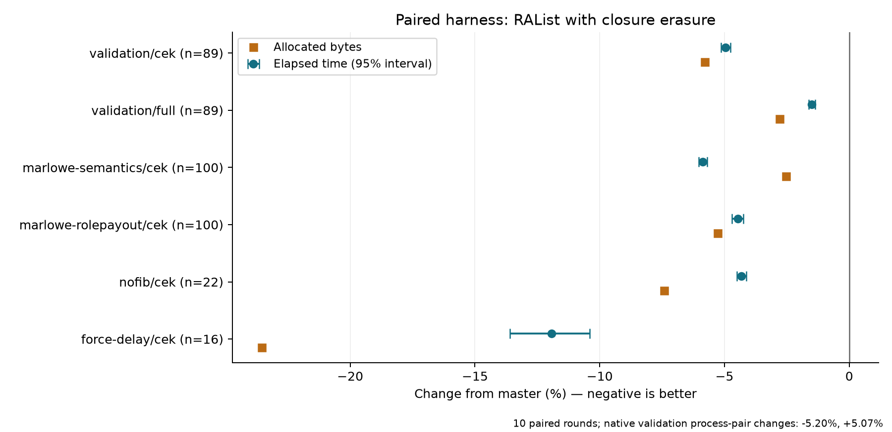

# Expanded comparison of scope-independent closure erasure

Measurements: 2026-10-08–09, America/Chicago.

This follow-up compares the unchanged `ra-erased-context` candidate with the
recorded origin/master commit `5d9feef021f94c0162c8ddcd6b4ec4780d37a5e5` on
`sho/scopeCheckOpt`. The candidate keeps the existing persistent RAList and
eliminates lambda/delay wrappers when the evaluator's current continuation
proves they will immediately be consumed. It does not change variable lookup,
scope checking, script syntax, or execution-budget charges.

This is an independent evaluator experiment, not an implementation that
benefits from scope checking. The scope-derived array experiments and their
negative results are documented in [README.md](README.md), with independently
applicable [patches](patches/README.md). The evaluator on this branch is restored
to the recorded master; `ra-erased-context` is available only by explicit selection.

The earlier custom harness already covered all 89 validation scripts. The
previous independent Criterion check covered only its 14-script `--quick`
subset. This follow-up runs the entire native validation benchmark, adds its
full deserialization/evaluation path, and extends the corpus substantially.

## Ten-round paired results

The candidate reduces validation CEK time by **4.96%** and allocated bytes by
**5.79%**. Including decoding, argument application, and scope checking, the
paired full-validation measurement improves by **1.50%**, with **2.79%** less
allocation. Every suite improves in aggregate, but individual performance
regressions remain.

The independent native validation benchmark does **not** reproduce a consistent
CEK improvement: its two process pairs change by −5.20% and +5.07%. Fresh
targeted repeats also confirm performance regressions. The candidate remains an
experiment; the 5% paired-harness gain is not an established production gain.

Negative changes mean less elapsed time or allocation. Intervals describe the
ten paired rounds on this fixed corpus.

| Suite | Cases | Elapsed-time change | 95% interval | Allocated bytes | Faster point estimates |
| --- | ---: | ---: | ---: | ---: | ---: |
| Validation, CEK | 89 | **−4.96%** | −5.14% to −4.76% | −5.79% | 82/89 |
| Validation, full | 89 | **−1.50%** | −1.63% to −1.37% | −2.79% | 71/89 |
| Marlowe semantics | 100 | −5.87% | −6.04% to −5.69% | −2.53% | 91/100 |
| Marlowe role payout | 100 | −4.46% | −4.70% to −4.24% | −5.28% | 96/100 |
| nofib | 22 | −4.31% | −4.49% to −4.13% | −7.43% | 18/22 |
| Force/delay | 16 | −11.93% | −13.59% to −10.40% | −23.55% | 16/16 |

Across all 327 CEK workloads the equal-workload geometric mean improves by
5.40%, with 7.64% less summed allocation. That pooled figure weights Marlowe's
200 transaction contexts heavily, so the separate suites are more informative.
The ratio of summed times improves by 4.37% for validation CEK, 1.47% for full
validation, and only 1.70% for Marlowe semantics: its slower cases benefit less
than its typical case. These differences are retained in the full tables.

Wall and process CPU ratios agree to approximately 0.01 percentage point.
Across all workload/mode combinations, master-first pairs improve by 4.61% and
candidate-first pairs by 4.54%. During the 22.6-minute paired run, the selected
core's SMT sibling was active for 0.37% of the observation interval; sampled
frequency had a 5.2 GHz median. The host was substantially quieter than in the
earlier experiments.



The [complete tables](results/comprehensive/paired-tables.md) include every
workload's absolute times, allocation, interval, family summary, and GC totals.
The [per-workload CSV](results/comprehensive/paired-per-script.csv) also contains
CPU and GC measurements. The [89-script plot](results/comprehensive/paired-validation.png)
shows the full validation CEK distribution, including regressions.

## Independent native benchmarks

All 20 native processes finish successfully, producing 1,664 per-case Criterion
estimates. Both pairs cover every case, without `--quick`. Negative changes mean
less time. The combined column is the geometric mean of the two process-pair
ratios; two pairs do not support a precise process-variation interval.

| Native target | Cases | First pair | Reversed-order pair | Combined |
| --- | ---: | ---: | ---: | ---: |
| Validation, CEK | 89 | −5.20% | **+5.07%** | −0.20% |
| Validation, full | 89 | −2.76% | −5.79% | −4.28% |
| Marlowe semantics | 100 | −7.83% | −7.87% | −7.85% |
| Marlowe role payout | 100 | −6.04% | +0.79% | −2.68% |
| nofib | 22 | −2.90% | −5.73% | −4.33% |
| Force/delay | 16 | −11.83% | −11.90% | −11.87% |

The native validation candidate's second process is 10.15% slower than its
first; master's second process is 0.62% faster. A first-round `coop-7` baseline
sample also has a 20.1% coefficient of variation. No observation is discarded.
The raw CSVs preserve Criterion's per-process intervals and standard deviations;
the [combined native CSV](results/comprehensive/canonical-per-script.csv) includes
those fields and coefficients of variation.

Unrelated Lean activity resumed during the native run, and recorded one-minute
load exceeded the primary run's range. This is an observed source of potential
interference, not an isolated explanation of the reversals. The harnesses also
have different runtimes and live input sets. The native measurements support
several suite-level gains but leave validation CEK performance inconclusive.
The narrow primary intervals describe repeated executions in that harness and
do not resolve this disagreement.

## Confirmed exceptions and GC sensitivity

Nine workloads were selected after the primary run, before the native full-path
results were available. A fresh 12-round comparison covers their 15 workload/mode
combinations at a 100 ms target. Two separate eight-round comparisons change
only the allocation nursery to 4 MiB and 16 MiB. The candidate code and binary
are unchanged. All results are in the [follow-up tables](results/comprehensive/followup-tables.md)
and [comparison CSV](results/comprehensive/followup-comparison.csv).

| Workload / mode | Main run | Fresh confirmation | Confirmation 95% interval |
| --- | ---: | ---: | ---: |
| `coop-1`, CEK | +0.85% | +2.17% | +1.78% to +2.59% |
| `coop-2`, CEK | +3.31% | +2.39% | +2.03% to +2.75% |
| `coop-7`, CEK | +3.33% | +3.55% | +3.16% to +4.13% |
| Primality, 5 digits | +2.57% | +2.08% | +1.71% to +2.43% |
| Primality, 30 digits | +1.25% | +1.41% | +1.01% to +1.90% |
| `future-increase-margin-2`, full | +4.68% | +4.90% | +4.49% to +5.31% |
| `future-settle-early-2`, full | +5.27% | +4.33% | +3.70% to +4.94% |
| `vesting-1`, CEK control | −9.69% | −9.84% | −10.21% to −9.37% |

The cooperative and primality CEK regressions persist despite lower allocation
and slightly lower GC time. For example, the five-digit primality case changes
from 2,432.71 to 2,483.23 µs while GC falls from 30.58 to 29.76 µs. These losses
occur outside recorded GC; this experiment does not isolate their cause.

The two selected futures scripts improve by about 9.1% in CEK-only execution,
yet regress by 4.3–4.9% in full evaluation. Full-path allocation falls by 3.31%,
but GC rises from approximately 109 to 141 µs per evaluation. The extra GC time
accounts for their elapsed-time regression in the fresh run.

At a 4 MiB nursery those full-path regressions remain (+4.39% and +9.17%, with
the latter interval wide). At 16 MiB they change to −0.50% [−1.81%, +0.66%] and
−2.08% [−3.19%, −1.13%]. This establishes GC sensitivity; it does not establish
the exact allocation/promotion mechanism. These nursery runs cover only the
selected subset and do not establish a new production GC configuration.

The practical direction remains to keep the existing RAList and investigate
closure erasure further. Separate its syntactic fast paths from continuation
erasure in a future experiment, profile the confirmed non-GC regressions, and
repeat native measurements under controlled host conditions before adoption.
The earlier [array comparison](README.md) already covers all 89 validation
scripts; these expanded measurements focus on the RAList candidate.

## Coverage and correctness

| Suite | Workloads | What is exercised |
| --- | ---: | --- |
| Validation, CEK | 89 | Every `validation/data/*.flat` file |
| Validation, full | 89 | The same scripts, serialized and supplied with their original data arguments |
| Marlowe semantics | 100 | SOP validator applied to 100 transaction contexts |
| Marlowe role payout | 100 | SOP validator applied to 100 transaction contexts |
| nofib | 22 | All native clausify, knights, primality, and queens benchmark inputs |
| Force/delay | 16 | All nested force/delay benchmark inputs |

There are 327 distinct workloads and 416 workload/mode combinations. Marlowe's
200 cases exercise two validator programs; they are not 200 independent
implementations. No workload was excluded.

The candidate exactly matches master's fully discharged CEK results, execution
budgets, and logs for all 327 workloads. The 89 full validation cases also
succeed with exactly matching execution budgets and logs. These checks run
before timing. Expected reports, per-case hashes, input hashes, and matching
native benchmark inventories are retained under `results/comprehensive`.
The candidate is unchanged from the earlier run that passed 919 upstream
untyped-core tests and the targeted closure/budget differential checks described
in [closure-erasure.md](closure-erasure.md).

## Measurement method

Two saved executables run sequentially on logical CPU 15, with RTS `-N1 -T -s
-K512M`. Each of ten rounds starts a fresh pair of processes, shuffles workload
order, and measures master and candidate adjacently on each workload. Their
order alternates across rounds, giving each workload five master-first and five
candidate-first pairs. Both sides use the same repetition count, calibrated for
at least approximately 75 ms of work per sample. Calibration, input loading,
forcing input terms, and forced collections between samples are outside timing.
Ordinary collections during evaluation are included.

The input is read through an `IORef` each iteration to prevent sharing a pure
evaluation result across repetitions. Each sample records wall time, process
CPU time, allocated bytes, GC CPU/wall time, and collection count. Allocation
accounting is flushed by an untimed collection after each sample; GC-time
statistics are captured before that collection. Process-wide peak residency is
not interpreted as environment memory: processes also retain benchmark inputs.

The custom process retains its workload catalog and current decoded term even
during full validation. The native full benchmark constructs its own benchmark
closure and has a different set of live inputs. Comparing both harnesses is
particularly useful for GC-sensitive cases; their absolute times are not
interchangeable.

All timing uses the repository's evaluation helpers and corresponding contexts:

- CEK validation and force/delay: PlutusV3, builtin semantics E.
- Marlowe and nofib: `mkMostRecentEvalCtx`, V4/semantics G at this commit.
- Full validation: V1/semantics A, `futurePV`, enormous restricting budget,
  serialized script decoding, argument application, full scope checking, and
  evaluation. Serialization and peeling the original data arguments happen
  before timing, matching `validation-full`.

Because the native CEK and full validation benchmarks use different semantics
configurations, their times should not be subtracted to estimate decoding cost.
Each candidate is compared with master under the same configuration.

The main time statistic is the equal-workload geometric mean of paired
candidate/master ratios. Confidence intervals resample the ten paired rounds
10,000 times, keeping the corpus fixed. They measure variability in this run,
not uncertainty over all deployed Cardano scripts. Individual script intervals
are nominal and have no multiple-comparison correction. The tables also give
process CPU ratios, sum-of-times ratios, summed per-evaluation allocation, and
GC shares. Summed totals count one execution of every workload; they are not a
mainnet workload distribution.

The independent Criterion runs use the repository's unmodified `validation`,
`validation-full`, `marlowe`, `nofib`, and `force-delay` executables, without
`--quick`: two process pairs per suite, `-L .1`, and 1,000 bootstrap resamples.
These native executables use their default non-threaded, single-threaded runtime
on the same CPU affinity. An initial invocation with explicit threaded RTS
flags was rejected before benchmarking; the failed command/log are retained
separately. Successful runs use no RTS overrides. Their raw CSVs, command
manifest, and complete logs are retained.

Hardware/toolchain: Ryzen 9 7950X, GHC 9.6.7, Cabal 3.12.1.0, evaluator at Cabal's
`-O1` build profile and custom harness at `-O2`, full crypto enabled. The existing
CPU governor and other processes are left alone. Builds, correctness checks,
and other benchmark runs do not overlap timed runs. Load, CPU activity, SMT
sibling activity, and frequency observations are recorded every two seconds.
The measurements remain specific to this host, build, and corpus.

## Reproduction

Use the same baseline commit and the development environment/configuration
recorded in [README.md](README.md). All binaries are saved separately before
measurement. From the repository root:

```bash
e=doc/notes/cek-scope-array/experiment
bash "$e/build-comprehensive.sh" ra-erased-context
bash "$e/build-comprehensive.sh" baseline
python3 "$e/run-comprehensive.py" check
python3 "$e/run-comprehensive.py" paired --rounds 10 --seconds .075
python3 "$e/run-comprehensive.py" canonical --rounds 2 --seconds .1
python3 "$e/run-comprehensive-followup.py"
# In a Python environment containing requirements-analysis.txt:
python3 "$e/analyze-comprehensive.py"
for prefix in confirmation nursery4m nursery16m; do
  python3 "$e/analyze-comprehensive.py" --prefix "$prefix" --skip-plots
done
python3 "$e/summarize-comprehensive-followup.py"
python3 "$e/package-comprehensive.py"
```

The selector restores production files to master when `baseline` is selected.
The branch keeps production sources at the recorded master. The independently
benchmarked `ra-erased-context` candidate is retained in `closure-variants.py`
and `results/ra-erased-context.patch.gz`.
The experiments and evidence remain on `sho/scopeCheckOpt`.

`results/comprehensive/completion.json` records checked coverage, source hashes,
and the restored baseline state at measurement completion. Later selector
refactoring for checkout detection and patch export does not change generated
evaluator source.
That directory also retains the Cabal plan, compressed build and runtime
logs, input/binary manifests, exact correctness reports, raw paired samples,
native Criterion files, and host telemetry. Text evidence uses normalized LF
line endings and trimmed trailing whitespace.
